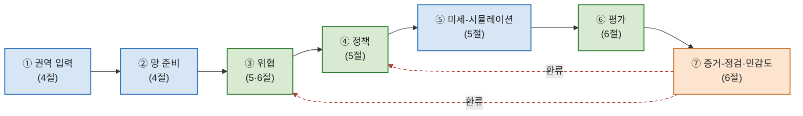

# 그림 1 재설계 — 통합 파이프라인 개념도 생성 프롬프트

> 대상: `<그림 1> 프레임워크의 3층 분할(A/B/C)과 일곱 계층 파이프라인 개념도`
> 목적: 현재 (가)+(나) 두 패널 구조를 **단일 파이프라인 개념도 하나**로 합쳐 다시 그리기 위한 생성 지시서.
> 사용법: 아래 **§3(이미지 생성 프롬프트)** 또는 **§4(Mermaid)** · **§5(좌표 사양)** 중 사용 도구에 맞는 것을 복사해 그림을 생성·제출.

---

## 1. 왜 (가)와 (나)를 합쳐야 하는가

- 현재 **(가) "시스템 3층 분할"** 패널은 A/B/C 세 가로 띠 + 설명문으로, 사실상 **텍스트 표**에 가깝다. 게다가 본문 **<표 2> 시스템 3층 분할(A 가정-처리 · B 실데이터 핵심 · C 비교 무대)**이 이미 같은 내용을 표로 담고 있어 **(가)는 표 2와 중복**이다.
- **(나) "일곱 계층 파이프라인"**이 이 그림의 핵심 구조다.
- 결론: (가)의 “층 의미”는 **색상 + 1줄 키(key)**로 압축해 (나)의 파이프라인 안으로 녹이고, 상세 정의는 표 2에 맡긴다. → **단일 개념도 1장**으로 (가)+(나)를 대체.

## 2. 단일 다이어그램이 전달해야 할 핵심 메시지

1. 프레임워크는 **일곱 계층**의 단방향 흐름(1→2→…→7)이지만, **7증거-점검이 3위협·4정책으로 환류**하는 **반복 구조**다(단방향 아님).
2. 일곱 계층 각각은 세 처리 층(A/B/C) 중 하나에 속하며, **색상**으로 소속을 즉시 알 수 있다.
3. 색상의 의미(A/B/C)는 간결한 키로 한 줄씩만 제시하고, 상세는 표 2로 연기한다.

## 3. AI 이미지 생성용 프롬프트 (English; 텍스트는 §3.1의 한국어 블록을 수동 배치 권장)

```
A clean, minimal academic framework diagram, horizontal layout, white background.
A single left-to-right pipeline of SEVEN rounded rectangular stage boxes connected by
thin gray rightward arrows. Each box is filled with a light tint and outlined in one of
three colors encoding its "layer":
  - orange (#c8742f) outline, light-orange (#fce4cf) fill  -> layer A
  - blue   (#2c6fbb) outline, light-blue   (#d6e6f5) fill  -> layer B
  - green  (#2e7d32) outline, light-green  (#d9ead3) fill  -> layer C
Box contents (large bold stage number on top, small stage name below):
  1 "권역 입력" (B/blue), 2 "망 준비" (B/blue), 3 "위협" (C/green),
  4 "정책" (C/green), 5 "미세-시뮬레이션" (B/blue), 6 "평가" (C/green),
  7 "증거-점검·민감도" (A/orange).
A dashed RED (#b23a3a) feedback arc curves ABOVE the boxes from box 7 back to boxes 3 and 4,
labeled in small red text: "환류: 증거-점검이 위협·정책 입력을 되돌려 줌".
Below the pipeline, a compact horizontal THREE-item color key (swatch + short label):
  orange = "A층 가정-처리 (전시 교리 가정 A1–A4로 봉합)"
  blue   = "B층 실데이터 핵심 (표준노드링크 도로망 실측)"
  green  = "C층 비교 무대 (두 대안이 갈라지는 기능적 구간)".
Title at top-left: "전시 동원수송 의사결정지원 프레임워크: 일곱 계층 파이프라인과 A/B/C 처리 층".
Style: thin clean lines, generous whitespace, sans-serif Korean labels, no 3D, no shadows,
no decorative icons. Aspect ratio about 16:7 (wide).
```

> 참고: 일반 래스터 이미지 생성기(DALL·E, Midjourney, Flux 계열)는 **한글 문자를 정확히 렌더하지 못한다**.
> 이 프롬프트로 **레이아웃·색상·구조**를 잡은 뒤, **문자는 벡터 도구(PowerPoint, Illustrator, draw.io, Figma)에서 수동 입력**하거나, 아래 §4(Mermaid) 또는 §5(좌표 사양)로 코드 생성하는 것이 가장 깔끔하다.

### 3.1 그림에 들어갈 정확한 한국어 텍스트 (복사용)

- 제목: `전시 동원수송 의사결정지원 프레임워크: 일곱 계층 파이프라인과 A/B/C 처리 층`
- 단계 박스(번호 / 이름 / 색 / 상세 절):
  - `1 / 권역 입력 / B / 4절`
  - `2 / 망 준비 / B / 4절`
  - `3 / 위협 / C / 5·6절`
  - `4 / 정책 / C / 5절`
  - `5 / 미세-시뮬레이션 / B / 5절`
  - `6 / 평가 / C / 6절`
  - `7 / 증거-점검·민감도 / A / 6절`
- 환류 라벨: `환류: 증거-점검이 위협·정책 입력을 되돌려 줌`
- 색상 키(3줄):
  - `A층 가정-처리 — 전시 교리 가정 A1–A4로 봉합하는 범위 조건 (상세: 표 2, 3.3절)`
  - `B층 실데이터 핵심 — 공식 표준노드링크 도로망을 실데이터로 구축·고정 (상세: 4절)`
  - `C층 비교 무대 — 두 대안 노출이 갈라지는 기능적 구간(접근로 A→S·종단 R→D·장거리 S→R) (상세: 5·7절)`

## 4. Mermaid 코드 (즉시 렌더·편집 가능; 구조와 색을 그대로 재현)



> 렌더 후, 하단에 §3.1의 색상 키 3줄과 환류 라벨 전문을 추가하고, 상단에 제목을 넣으면 최종 그림이 완성된다.

## 5. 정밀 좌표 사양 (SVG / draw.io / matplotlib 수작업용)

- 캔버스: 가로 14, 세로 6 단위(비율 약 7:3). 흰 배경.
- 단계 박스: 너비 1.62, 높이 1.1, x=0.3+i×1.92, y=2.0 (i=0..6). 둥근 모서리(rounding 0.07).
- 박스 내부: 상단에 큰 굵은 번호(중앙), 하단에 단계명(중앙, 본문 222색).
- 전진 화살표: 인접 박스 사이, 회색(#888888), 선굵기 1.0.
- 환류 호: 박스7 상단(y≈3.1)에서 박스3·4 상단으로 휘어 올라가는 점선 빨강(#b23a3a), 곡률 rad≈-0.32. 상단 중앙에 환류 라벨.
- 색상(외곽선 / 채우기): A = #c8742f / #fce4cf, B = #2c6fbb / #d6e6f5, C = #2e7d32 / #d9ead3.
- 하단 키(y≈0.7): 세 개의 작은 색 사각형 + 각각 §3.1의 한 줄 설명. 폰트 8–9pt.
- 상단 좌(y≈5.4): 제목.

## 6. 배치도 (ASCII 미리보기)

```
 ┌──── 전시 동원수송 의사결정지원 프레임워크: 일곱 계층 파이프라인과 A/B/C 처리 층 ────

        ╭─────────────── 환류: 증거-점겘이 위협·정책 입력을 되돌려 줌 ───────────────╮  (점선 빨강)
        │                                                                  │
   ┌──┐→┌──┐→┌──┐→┌──┐→┌──┐→┌──┐→┌──┐  ← 7이 3·4로 환류
   │① │ │② │ │③ │ │④ │ │⑤ │ │⑥ │ │⑦ │
   │권역│ │망 │ │위협│ │정책│ │미세│ │평가│ │증거│
   │입력│ │준비│ │    │ │    │ │시뮬│ │    │ │점검│
   └──┘ └──┘ └──┘ └──┘ └──┘ └──┘ └──┘
    (B)  (B)  (C)  (C)  (B)  (C)  (A)      ← 파랑=B / 초록=C / 주황=A

   ■ A층 가정-처리   ■ B층 실데이터 핵심   ■ C층 비교 무대     (상세: 표 2)
```

## 7. 주의 (claim discipline 유지)

- 그림은 “의사결정지원·준실험·민감도” 프레임워크를 묘사한다. **‘최적경로·검증·실측(긍정)·운영·예측’ 등의 단어는 금지**.
- “7증거-점검”은 본문의 단계명(‘증거-점검·민감도’)을 그대로 쓴다(코드 변수명이 아님).
- 환류 화살표는 **단방향 파이프라인이 아님**을 강조하는 핵심 요소 — 반드시 포함.
